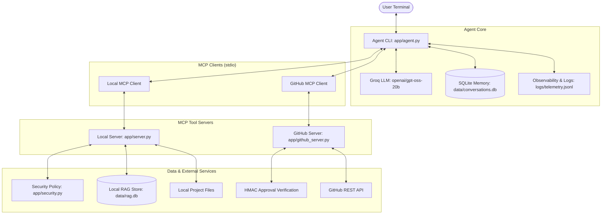

# MCP-Powered Developer Assistant

An intelligent, secure developer assistant that connects to your local codebase and GitHub using the **Model Context Protocol (MCP)**. It uses **Retrieval-Augmented Generation (RAG)** for semantic code search, remembers past conversations with **SQLite memory**, and protects sensitive operations with **human approval**.

---

## 1. Project Overview

Software developers constantly switch between their code editor, documentation, terminal, and GitHub issues. This context switching slows down development.

I built this project to create an AI assistant that lives directly in the terminal and can:
- **Search and understand code** using local semantic search.
- **Read local files securely** without leaking secrets or modifying files unexpectedly.
- **Interact with GitHub** to view repositories, inspect issues, and safely draft new issues.
- **Remember conversations** across restarts so you do not lose context.
- **Enforce security and safety** through server-side permission checks and explicit human approval before any write operation.

---

## 2. Key Features

- **Model Context Protocol (MCP SDK v2)**: Communicates with tool servers using standardized client/server architecture over standard I/O (stdio).
- **Fast AI Agent**: Powered by Groq (`openai/gpt-oss-20b`) for rapid reasoning, planning, and multi-step tool execution.
- **Local RAG & Code Search**: Indexes local code chunks into an embedded vector database (`data/rag.db`) using deterministic subword embeddings. Runs 100% locally with zero external API calls or embedding costs.
- **Scope-Aware Chunking**: Automatically detects functions, classes, and markdown headings to preserve technical context.
- **Fast Incremental Indexing**: Detects added, modified, and deleted files using file modification times (`mtime`) and SHA-256 hashes without rebuilding the whole database.
- **Exact Source Citations**: Returns exact file paths and line ranges (e.g. `app/rag.py:78-120`) with every code search result.
- **Persistent Conversation Memory**: Stores LangGraph conversation state in a local SQLite checkpointer (`data/conversations.db`). Automatically resumes your last session when restarted.
- **Interactive Session Commands**: Start fresh anytime with `/reset` or `/new`, or force re-indexing with `/index`.
- **Human Approval for Write Actions**: Drafting an issue never creates it directly. The application requires terminal confirmation (`CREATE`) and validates a cryptographic HMAC approval token on the server before GitHub issue creation.
- **Server-Side Security Policy**: Blocks path traversal attacks, prevents reading `.env` and credential files, and redacts API keys and private keys from logs.
- **Observability & Audit Logs**: Records fine-grained operational metrics with correlation IDs in `logs/telemetry.jsonl` and immutable safety records in `logs/audit.jsonl`.

---

## 3. How It Works

Here is the step-by-step flow when you ask a question:

1. **User Input**: You type a question or task in the terminal prompt (e.g., *"How is issue draft validation implemented?"*).
2. **Correlation & Memory**: The application assigns a unique correlation ID (`trace_id`) and loads your current conversation history from the SQLite database.
3. **AI Planning**: The Groq LLM analyzes your request and decides which MCP tools to call.
4. **Tool Execution via MCP**:
   - For code questions, the assistant calls `search_codebase` or `read_file` on the local MCP server.
   - For GitHub questions, the assistant calls `list_issues` or `get_issue` on the GitHub MCP server.
5. **Security Verification**: The server verifies that the requested path is inside the project and not in an excluded directory or secret file.
6. **Tool Results to LLM**: Tool outputs return to the agent with exact file citations and line numbers.
7. **Human Approval Check (if applicable)**: If the agent drafts an issue, it calls `draft_github_issue`. The assistant pauses and asks you to type `CREATE` in the terminal.
8. **Final Answer & Telemetry**: The assistant outputs the answer, displays the Trace ID, records token usage and latencies, and saves the conversation state.

---

## 4. Architecture Diagram



---

## 5. Tech Stack

| Technology | Purpose |
| :--- | :--- |
| **Python 3.12+** | Core programming language |
| **Model Context Protocol (MCP)** | Standardized protocol (`mcp>=1.2.0`) for connecting tools to LLMs |
| **LangChain & LangGraph** | Agent orchestration, multi-step tool execution, and state graphs |
| **Groq API (`langchain-groq`)** | High-speed LLM inference using open models (`openai/gpt-oss-20b`) |
| **SQLite (`aiosqlite`)** | Local, embedded database for conversation checkpoints and vector chunks |
| **LocalEmbedder & SQLite RAG** | Deterministic 256-dimensional subword and trigram dense embeddings |
| **HMAC & SHA-256** | Cryptographic token verification for human-in-the-loop issue approval |
| **python-dotenv** | Secure local environment variable management |

---

## 6. Project Structure

```text
dev_assistant/
├── app/
│   ├── agent.py            # Main CLI assistant and LangGraph agent workflow
│   ├── server.py           # Local MCP server (list_files, read_file, search_codebase, index_codebase)
│   ├── github_server.py    # GitHub MCP server (list_repositories, list_issues, get_issue, create_issue)
│   ├── rag.py              # Local RAG engine: chunking, embedding, hybrid search, incremental indexing
│   ├── security.py         # Centralized security policy, path traversal checks, HMAC tokens
│   └── observability.py    # Request tracing, correlation IDs, latency tracking, secret redaction
├── data/                   # Local databases (auto-created, excluded from Git)
│   ├── conversations.db    # Persistent SQLite conversation checkpoint memory
│   ├── last_thread.txt     # Active session thread ID
│   └── rag.db              # Vector database storing chunks and incremental file metadata
├── eval/
│   ├── dataset.json        # 12 representative evaluation test cases
│   ├── evaluate.py         # Automated evaluation harness for RAG, security, tools, and latency
│   ├── results.json        # Detailed evaluation pass/fail results and metrics
│   └── README.md           # Evaluation and observability documentation
├── logs/                   # Structured log files (excluded from Git)
│   ├── audit.jsonl         # Application safety and audit trail with trace IDs
│   └── telemetry.jsonl     # Fine-grained metrics, token counts, and latencies
├── .env.example            # Environment variables configuration template
├── .gitignore              # Protects data, virtual environments, logs, and secrets
└── README.md               # Project documentation
```

---

## 7. Setup Guide

### Prerequisites
- Python 3.11 or 3.12 installed on your computer.
- A free **Groq API key** (from [console.groq.com](https://console.groq.com)).
- A **GitHub Personal Access Token** with `repo` or `issues` scope (from [github.com/settings/tokens](https://github.com/settings/tokens)).

### Step 1: Clone the Repository
```powershell
git clone https://github.com/your-username/dev_assistant.git
cd dev_assistant
```

### Step 2: Create and Activate Virtual Environment
On Windows (PowerShell):
```powershell
python -m venv .venv
.\.venv\Scripts\Activate.ps1
```

### Step 3: Install Dependencies
```powershell
pip install -r requirements.txt
# or install core packages:
pip install mcp langchain langchain-groq langgraph langgraph-checkpoint-sqlite aiosqlite python-dotenv requests
```

### Step 4: Configure Environment Variables
Copy `.env.example` to `.env`:
```powershell
Copy-Item .env.example .env
```
Open `.env` and fill in your keys:
```env
GROQ_API_KEY=gsk_your_actual_groq_api_key_here
GITHUB_TOKEN=ghp_your_actual_github_token_here
GITHUB_OWNER=your_github_username
GITHUB_REPO=your_target_repository_name
GITHUB_ALLOW_WRITE=true
```

> **Note:** `.env` is listed in `.gitignore` and is never committed to Git.

---

## 8. How to Run

### Start the Assistant
Run the agent using Python:
```powershell
py app/agent.py
# or
.\.venv\Scripts\python.exe app/agent.py
```

When started, the assistant automatically:
1. Connects to the local and GitHub MCP servers.
2. Initializes or connects to the SQLite conversation database.
3. Performs an initial codebase index if `data/rag.db` is empty.
4. Displays the ready banner:

```text
MCP Developer Assistant ready.
Connected to local project (with RAG search) and GitHub MCP servers.
GitHub issue creation requires terminal approval.
Audit log: F:\Python\dev_assistant\logs\audit.jsonl
Memory storage: SQLite persistent database (F:\Python\dev_assistant\data\conversations.db)
Active Conversation ID: 87ebf0f7-1c94-4f06-97bf-b4b33c36e379
Commands: '/index' to re-index, '/reset' or '/new' to start fresh, 'exit' to quit.

You:
```

### Assistant Commands
- `/reset` or `/new`: Clears the active conversation context and starts a fresh thread ID.
- `/index`: Forces an incremental re-index of the codebase into the RAG database.
- `exit` or `quit`: Exits the assistant safely.

---

## 9. Example Requests

Here are realistic prompts you can type into the assistant:

### 1. Codebase Exploration
> **You:** "What source files exist in the project?"  
> *The assistant calls `list_files` and returns the file tree without development clutter.*

### 2. Semantic Code Search (RAG)
> **You:** "Where and how is the deterministic semantic embedding implemented?"  
> *The assistant calls `search_codebase`, finds the relevant chunk in `app/rag.py`, and explains the code citing `Citation: app/rag.py:78-120`.*

### 3. Reading Specific Code
> **You:** "Read app/security.py and explain how path traversal is blocked."  
> *The assistant calls `read_file` with `app/security.py` and describes the `relative_to` validation.*

### 4. GitHub Issue Inspection
> **You:** "List the latest open issues in our GitHub repository."  
> *The assistant calls `list_issues` and summarizes issue numbers and titles.*

### 5. Safe GitHub Issue Creation
> **You:** "Propose a new issue titled 'Add health check endpoint' describing the need for container liveness probes."  
> *The assistant drafts the issue using `draft_github_issue`, displays the proposal, and prompts:*
> ```text
> --- GitHub Issue Approval Required ---
> Repository: octocat/Hello-World
> Title: Add health check endpoint
> Body: This issue was proposed by the developer assistant...
> 
> Type CREATE to submit this exact issue, or anything else to cancel:
> ```
> *If you type `CREATE`, it generates an HMAC approval token and creates the issue. If you type anything else, it safely cancels.*

---

## 10. Security & Safety Controls

Security is built into every layer of this project:

- **Server-Side Enforcement**: Tool permissions are validated on the server side (`app/server.py` and `app/github_server.py`), not just trusted to the LLM's system prompt.
- **Path Traversal Protection**: Files cannot be accessed outside the project root directory. Any `../` path traversal attempt raises `PermissionError`.
- **Sensitive File Exclusion**: `.env` files, certificates, private keys, database files, and virtual environments are blocked from reading and excluded from RAG indexing.
- **Content Redaction**: Before code chunks or logs are saved, regular expressions sanitize API keys (`gsk_*`, `ghp_*`), Bearer tokens, and private keys.
- **HMAC Human Approval Token**: GitHub issue creation requires an explicit cryptographic HMAC token tied to `(owner, repo, title)`. An LLM cannot execute write operations autonomously.
- **Duplicate Prevention**: Before creating an issue, the system checks existing repository issues to prevent accidental duplicates.

---

## 11. Current Limitations

- **Terminal Interface**: The assistant currently runs as a command-line interface (CLI) in the terminal; there is no web frontend yet.
- **Read-Only Local Files**: By design, the assistant can only read local files; it cannot edit or create files on your disk.
- **File Size Limit**: Files larger than 200 KB for reading or 500 KB for RAG indexing are skipped to prevent memory spikes.
- **API Rate Limits**: LLM responses depend on Groq API rate limits and token availability.

---

## 12. Future Improvements

- **Web Dashboard**: Build a clean web UI (e.g. Next.js or FastAPI with WebSocket) for graphical chat and issue management.
- **Multi-Repository Workspaces**: Support indexing and searching multiple Git repositories simultaneously.
- **File Modification Safeguards**: Add interactive code editing with user-approved unified diff previews.
- **Pull Request Inspection**: Add MCP tools to read pull requests, commit diffs, and review comments.

---

## 13. Running the Evaluation Suite

You can evaluate the assistant's performance, RAG retrieval accuracy, and safety controls anytime:

```powershell
.venv\Scripts\python.exe eval/evaluate.py
```

The evaluation script runs 12 automated checks across RAG semantic search, security path traversal, approval token generation, memory persistence, and error resilience. Detailed metrics are saved to `eval/results.json`.
